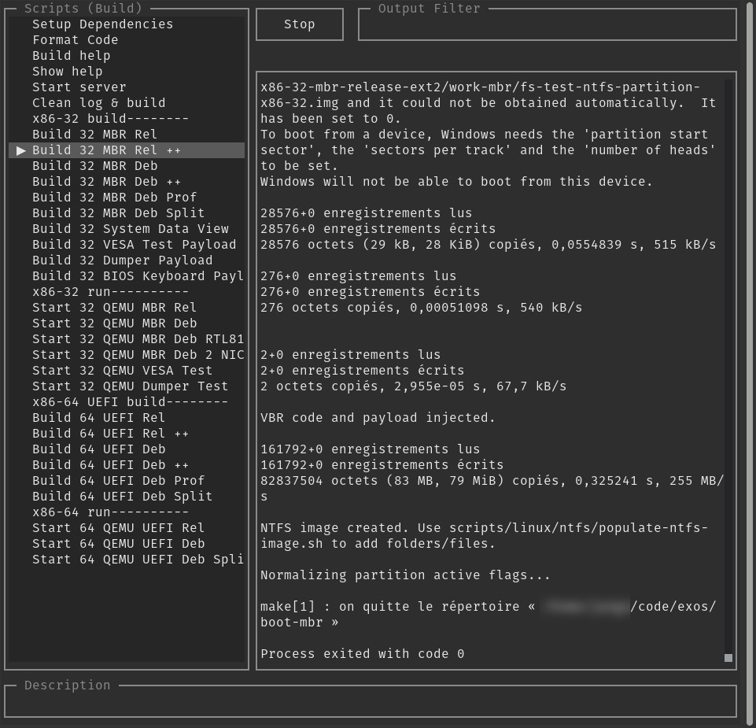

# Dashboard



[](https://github.com/Jango73/dashboard/actions/workflows/build.yml)

Terminal dashboard engine (Node.js + `OpenTUI`).

## Mounting

Add the submodule at `dashboard/` in the host project (or `backend/dashboard/` when the dashboard configuration lives in `backend/`):

```sh
git submodule add -b main git@github.com:Jango73/dashboard.git dashboard
```

The host project must provide the runtime dependencies (`@opentui/core`, `tail`, `kill-port`, see `package.json`) through its own `npm install`, and a `dashboard.json` in its working directory. Launch from the project root so the engine finds the project configuration:

```sh
./dashboard/dashboard.sh
```

Keep a thin `./dashboard.sh` shim at the project root when existing shortcuts or documentation reference it.

## `dashboard.json` format

Full example (all keys optional unless noted):

```json
{
    "scriptsDir": "scripts",
    "logs": ["log/app-{{latest}}.log"],
    "commandSets": [
        { "name": "main", "commands": [
            { "label": "Start API", "script": "start-api.sh", "key": "control+a", "promptCwd": false, "danger": false, "disabled": false, "description": "Starts the API on port 3000" },
            { "label": "--------" }
        ] }
    ],
    "settings": { "enableCommandHistory": true, "persistLogs": true, "logDir": "log", "notifyOnExit": true, "showCustomCommand": true, "showLogWindow": true, "renderThrottleMs": 100, "maxLogLines": 1000, "logBatchSize": 50, "maxQueuedLogLines": 2000, "sidebarMinWidth": 32 },
    "events": {
        "onDashboardStart": [
            { "action": "closeTCPPorts", "parameters": ["3000"] }
        ],
        "beforeStartProcess": [
            { "script": "start-api", "actions": [
                { "action": "killProcess", "parameters": ["node server.js"] }
            ] }
        ]
    }
}
```

Top-level keys:

- `scriptsDir`: directory (relative to the working directory) where script files live. Default is `./scripts`. When a command's `script` file is not found there, the value is executed directly as a shell command.
- `logs`: list of log file paths shown in the upper log panels. A path may contain `{{latest}}` as a placeholder for a dated file, for example `log/app-{{latest}}.log` matches `log/app-2026-01-15.log` or `log/app-2026-01-15T10-30-00.log` and follows the newest one (checked every minute). When nothing matches yet, it falls back to `log/app-latest.log`.
- `commandSets`: list of sidebar groups. Each group has a `name` (shown in the sidebar title) and a `commands` list. Switch between groups with `ctrl+left` / `ctrl+right`. When present, this replaces the legacy top-level `commands` list.
- `commands` (legacy): plain list of commands used when `commandSets` is absent. Same entry format as below. A string entry is shorthand for `{ "label": "<string>", "script": "<string>" }`.
- `keyBindings` (legacy): object mapping a key to a command, for example `{ "control+b": "start-api.sh" }`. Same entry format as below. Still accepted, listed before `commands`.
- `settings`: display and logging options, see below.
- `events`: automatic cleanup actions, see below. Legacy top-level `onDashboardStart` (list) and `beforeStartProcess` (object mapping script name to action list) are still accepted and merged into `events`.

Command entry fields (used in `commandSets[].commands`, `commands`, and `keyBindings` values):

- `label`: text shown in the sidebar. When it is the only key (for example `{ "label": "--------" }`), the entry is a non-selectable separator.
- `script`: script file name inside `scriptsDir` (for example `start-api.sh`), or a shell command when no such file exists. An empty or missing `script` makes the entry non-selectable.
- `key`: optional shortcut, written as whole words joined with `+`. Examples: `control+b`, `control+shift+s`, `shift+a`, `alt+c`, `function+f1`, `escape`, `f5`. Accepted words: `control` (or `ctrl`), `shift`, `alt` (or `meta`), `function` (or `fn`, only with an F-key such as F1, because the Fn key alone sends nothing to the terminal). Old shorthand (`C-b`, `S-a`, `M-c`) still works. A lone uppercase letter means Shift plus that letter. An invalid spec binds nothing, the entry stays clickable. First entry wins when two entries share a key.
- `promptCwd`: when true, a folder selector opens before launch and the chosen folder becomes the process working directory. Cancelling aborts the launch. Aliases: `cwdPrompt`, `askCwd`, `cwdRequired`. Default is false.
- `danger`: when true, the sidebar label gets a `! ` prefix to mark a destructive action. Default is false.
- `disabled`: when true, the entry is hidden from the sidebar. Default is false.
- `description`: short text shown in the full-width footer while the entry is highlighted. Anything but a non-empty string leaves the footer empty.

`settings` fields (all optional, defaults shown in the example above):

- `enableCommandHistory`: when true, `up` / `down` in the Custom Command input recalls previous commands. Default true.
- `persistLogs`: when true, process output is appended to a `dash-<timestamp>.log` file. Default true.
- `logDir`: directory for persisted logs, relative to the working directory. Default `log`. Only used when `persistLogs` is true.
- `notifyOnExit`: when true, the terminal beeps when a process exits. Default true.
- `showCustomCommand`: when false, the Custom Command input is hidden. Default true.
- `showLogWindow`: when false, the upper log panels are hidden. Default true.
- `renderThrottleMs`: minimum delay in milliseconds between screen refreshes during log bursts. Higher values use less CPU but feel laggier. Default 100.
- `maxLogLines`: maximum lines kept per view (log panels and process output). Older lines are replaced by a `... [log cleared ...]` marker. Default 1000.
- `logBatchSize`: lines flushed per tick from the file tailer to the screen. Lower values stay smoother under heavy logs. Default 50.
- `maxQueuedLogLines`: maximum lines buffered while waiting to be displayed. Overflow drops the oldest buffered lines and shows a `... [log backlog trimmed ...]` marker. Also caps the remembered process output history used by the `ctrl+r` rerun. Default 2000.
- `sidebarMinWidth`: fixed sidebar width in columns, minimum 32. The right side takes the remaining space. Default 32.

`events` fields:

- `onDashboardStart`: list of actions executed once when the dashboard starts. Each item is `{ "action": "<name>", "parameters": [...] }`.
- `beforeStartProcess`: list of `{ "script": "<name>", "actions": [...] }` hooks executed before a script starts. `script` is matched against the launched file's base name without extension, so `start-api.sh` matches `"start-api"`. The `npm run <name>` path matches on the full task name.
- Action `killProcess`: `parameters` is a list of process IDs (`"1234"`) or name substrings matched against each process command line (`"node server.js"`). Each match gets SIGTERM, then SIGKILL after 1.5 s when still alive. The dashboard itself is never killed.
- Action `closeTCPPorts` / `closeUDPPorts`: `parameters` is a list of port numbers (`["3000", "5432"]`). Each port is closed with the matching protocol. Failures are printed in the output panel instead of aborting the launch.
